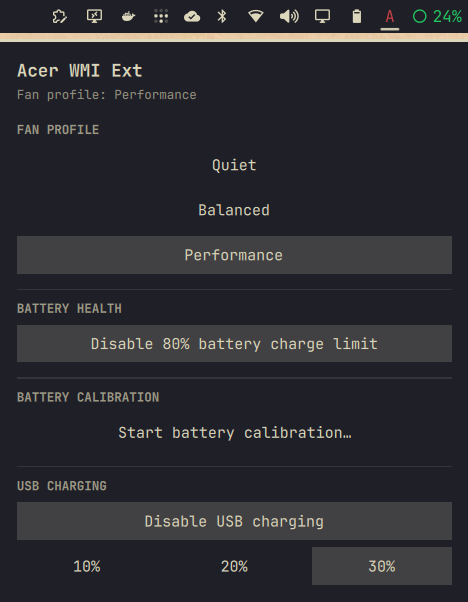

# Acer WMI Ext for Omarchy

An Omarchy bar plugin by **yudopr**, based on the experimental [`acer-wmi-ext`](https://github.com/TenSeventy7/acer-wmi-ext) kernel driver by TenSeventy7:

- **Fan profile:** Quiet, Balanced, or Performance through Omarchy's power-profile tooling.
- **Battery health:** Toggle the driver's 80% charge limit.
- **Battery calibration:** Start or stop a calibration cycle. Starting requires confirmation.
- **USB charging:** Enable or disable charging and select a 10%, 20%, or 30% limit when the laptop and driver support it.



The widget only displays controls that the driver reports as available. Fan and USB controls are hardware-specific; the upstream driver currently documents the Acer Swift Go 14 (SFG14-73). Battery controls depend on WMI support in the laptop. This plugin cannot add hardware support that the kernel driver does not provide.

## Requirements

- Omarchy shell with third-party plugin support.
- The `acer-wmi-ext` kernel module loaded. To build and load it for the current boot, use the optional driver installer below.
- `git`, `make`, `sudo`, a C toolchain, and headers matching the running kernel for the optional driver installer. On Omarchy, install the header package matching the running kernel (for example, `linux-omarchy-headers`).
- `power-profiles-daemon` and Omarchy's `omarchy-powerprofiles-*` commands for fan-profile switching.
- `pkexec`, polkit, and an active Omarchy polkit authentication agent for battery and USB changes.

## Install

Install the published plugin with Omarchy:

```sh
omarchy plugin add https://github.com/yudopr11/omarchy-acer-wmi-ext.git --enable
```

Then, from the installed plugin directory, install its narrow privileged helper and polkit action:

```sh
cd ~/.config/omarchy/plugins/org.tenseventyseven.acer-wmi-ext
./scripts/install-helper.sh
```

The helper install is a separate, explicit step. Review `scripts/acer-wmi-ext-omarchy-control` and `polkit/org.acer-wmi-ext.omarchy.policy` before running it. The script installs a root-owned helper at `/usr/local/bin/acer-wmi-ext-omarchy` and a polkit action under `/usr/share/polkit-1/actions/`. The plugin uses this helper only for the whitelisted battery and USB sysfs operations; it does not run `sudo` itself. Fan profiles use Omarchy's power-profile command and do not require this helper.

### Load the kernel driver

If the widget reports that `acer-wmi-ext` is not loaded, run this optional installer from an interactive terminal in the plugin directory:

```sh
./scripts/install-driver.sh
```

The script fetches upstream commit `78aaf9392e1fbdd62c3ec9944e9615505485ec04`, builds it against the running kernel's headers, asks before loading it with `sudo`, and removes its temporary build files afterward. It does **not** install the module or configure it to load at boot; run it again after reboot. If Secure Boot blocks the unsigned module, the script stops and reports the load failure rather than changing Secure Boot settings. Review `scripts/install-driver.sh` before running it.

For a local checkout, run these commands from the repository root. This copies the plugin files (without its `.git` metadata) into Omarchy's plugin directory:

```sh
plugin="$HOME/.config/omarchy/plugins/org.tenseventyseven.acer-wmi-ext"
mkdir -p "$plugin"
cp -a LICENSE Model.js Panel.qml README.md manifest.json assets docs polkit scripts tests "$plugin/"
cd "$plugin"
omarchy plugin validate .
omarchy plugin enable org.tenseventyseven.acer-wmi-ext right
```

## Calibration warning

Connect AC power before starting calibration. The driver charges the battery to 100%, discharges it, and charges it again; this can take hours, and the laptop should not be used during the cycle. Calibration disables battery health mode. The driver does not handle the event that signals completion, so **you must manually stop calibration** from this widget after the cycle finishes.

## Notes

- Fan profiles are selected through `omarchy-powerprofiles-set autodetect <profile>`, keeping power-profiles-daemon state in sync with the driver. This widget does not write `system_control_mode` directly.
- USB limit options are shown only while USB charging is enabled. The driver accepts only 10, 20, and 30 percent.
- On Acer Swift Go 14 (SFG14-73), the driver is detected and reports supported controls. Actual fan, battery, calibration, and USB behavior has not been exercised in this session; verify it on your device and follow the upstream driver's guidance.
- Removing the plugin does not remove the system helper or polkit policy. To remove those separately, run `sudo rm /usr/local/bin/acer-wmi-ext-omarchy /usr/share/polkit-1/actions/org.acer-wmi-ext.omarchy.policy`.

## License

GPL-2.0-or-later. See [`LICENSE`](LICENSE).
